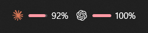
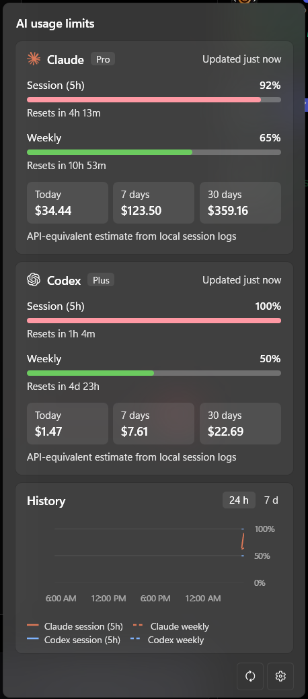

# Lidget

Lidget is a Windows 11 taskbar widget that shows the usage limits of AI subscription plans.
It tracks Claude (Pro and Max plans, through Claude Code) and Codex (ChatGPT plans, through the Codex CLI).





## Current behavior

- The widget in the taskbar shows the tightest limit of each provider as a bar and a percentage.
  The bar is green below 75%, amber from 75%, and red from 90%.
- A click on the widget opens a flyout. For each provider, the flyout shows:
  - The session limit (5 hours) and the weekly limit, with reset countdowns.
  - The API-equivalent cost for today, the last 7 days, and the last 30 days, from local session logs.
  - A history chart of the last 24 hours or 7 days.
- A toast notification shows when a limit passes 80% and 95%. Each threshold notifies one time for each limit window.
- If Lidget cannot join the taskbar, it shows the widget in a small window in the bottom-right corner of the screen.
- Settings: providers, the widget metric, the refresh interval (5 minutes by default), thresholds, start with Windows, and history retention.
- Lidget checks GitHub Releases for updates every 24 hours, and installs a downloaded update at the next start.

Lidget is in development. No release is published yet.
[The MVP plan](docs/plans/lidget-mvp.md) describes the remaining work.

## Requirements

- Windows 11 with the taskbar at the bottom of the screen.
- For Claude: [Claude Code](https://code.claude.com), signed in with a Claude.ai Pro or Max plan.
- For Codex: the [Codex CLI](https://github.com/openai/codex), signed in with `codex login`.

## Install

1. Download `Lidget-win-Setup.exe` from the GitHub Releases page of this repository.
2. Run the installer.
   The installer is not signed, so Microsoft Defender SmartScreen can show "Windows protected your PC".
   To continue, select **More info**, and then select **Run anyway**.
3. Find the widget at the right side of the taskbar, near the system tray.

Lidget installs in `%LOCALAPPDATA%\Lidget` and adds a Start menu shortcut.
To uninstall Lidget, use **Settings** > **Apps** > **Installed apps** in Windows.
The uninstaller keeps the user data in `%LOCALAPPDATA%\LidgetData`.

## Data sources

Lidget reads the logins of Claude Code and the Codex CLI on this computer.
Lidget does not send data to a server other than the providers and GitHub.

| Provider | Source | Notes |
| --- | --- | --- |
| Claude | `https://api.anthropic.com/api/oauth/usage`, with the Claude Code login in `~/.claude/.credentials.json` | This endpoint is not documented by Anthropic and can change without notice. |
| Claude | The Claude Code statusline (optional, off by default) | In Settings, turn on **Read limits from Claude Code while you work**. Lidget then wraps your statusline command in `~/.claude/settings.json`. |
| Codex | `codex app-server`, started from the Codex CLI | Lidget reads the rate limits of the signed-in account. |
| Both | Session logs in `~/.claude/projects` and `~/.codex/sessions` | Lidget calculates the cost estimates from these logs. |

When the Claude access token expires, Lidget refreshes it.
Claude Code refresh tokens are single-use, so Lidget writes the new tokens back to `~/.claude/.credentials.json`.
Lidget does not write to Codex files.

`CLAUDE_CONFIG_DIR` and `CODEX_HOME` change the Claude Code and Codex folders, as they do for the CLIs.

## Files that Lidget writes

| Location | Content |
| --- | --- |
| `%LOCALAPPDATA%\LidgetData\settings.json` | Settings |
| `%LOCALAPPDATA%\LidgetData\history.db` | Limit history (SQLite) |
| `%LOCALAPPDATA%\LidgetData\cost-cache.db` | Parsed session log data for the cost estimates (SQLite) |
| `%LOCALAPPDATA%\LidgetData\notifications.json` | The thresholds that notified in each limit window |
| `%LOCALAPPDATA%\LidgetData\claude-statusline.json` and `statusline-original.json` | The statusline feed, and your original statusline setting |
| `%LOCALAPPDATA%\LidgetData\logs\` | Logs for the last 7 days. Logs do not contain tokens. |
| `HKCU\Software\Microsoft\Windows\CurrentVersion\Run`, value `Lidget` | Start with Windows |

**Settings** > **Open data folder** opens `%LOCALAPPDATA%\LidgetData`.

## Cost estimates

The cost tiles show what the tokens in your session logs cost at API prices.
Your subscription price does not change.
The prices come from `assets/pricing.json`, which comes from the OpenUsage and LiteLLM price lists.
If a model is not in the price list, the flyout names the model, and the totals do not include its tokens.

## Build and test

Prerequisites: Windows 11 and the .NET 10 SDK.

```powershell
dotnet build Lidget.sln
dotnet test Lidget.sln
```

To start the Debug build, run `src\Lidget.App\bin\Debug\net10.0-windows10.0.22621.0\Lidget.exe`.
A Debug build does not check for updates, and it does not change the start-with-Windows registry value at start.

To make an installer, run this command.
It needs the Visual Studio C++ build tools for the NativeAOT publish of `lidget-statusline.exe`.

```powershell
./scripts/pack.ps1 -Version 0.1.0
```

The installer and the update packages are in `artifacts\releases`.

| Variable | Effect |
| --- | --- |
| `LIDGET_DATA_DIR` | Uses a different data folder |
| `LIDGET_DEBUG_LOG=1` | Writes debug messages to the log |
| `LIDGET_FORCE_FALLBACK=1` | Shows the floating window instead of the taskbar widget |
| `LIDGET_UPDATE_FEED` | Uses a folder or URL as the update feed, for example `artifacts\releases` |

[The QA checklist](docs/qa-checklist.md) lists the manual checks for a release.

## License

Lidget uses the [MIT license](LICENSE).
[THIRD-PARTY-NOTICES.md](THIRD-PARTY-NOTICES.md) lists the code, data, and packages from other projects.
